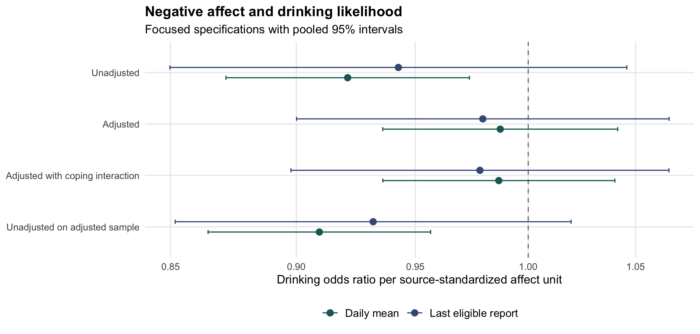
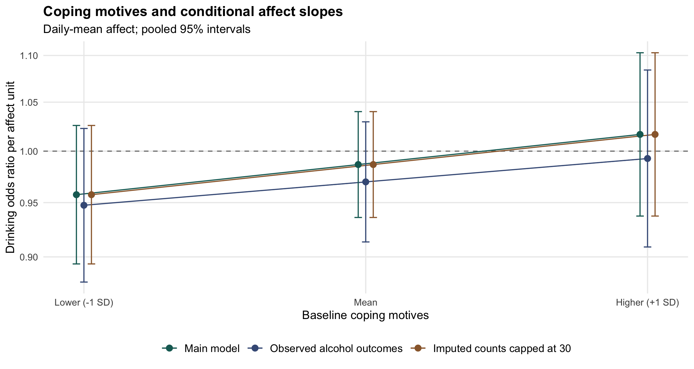
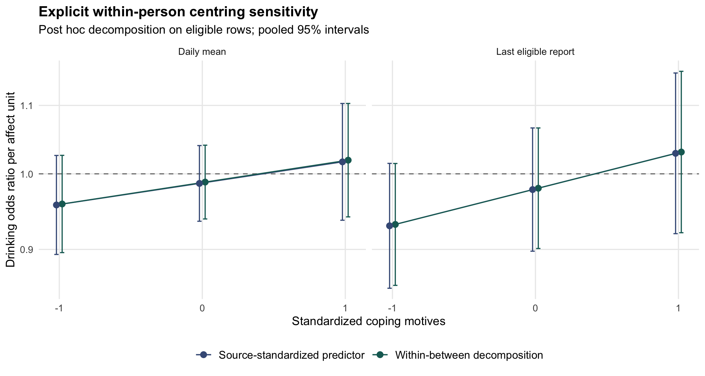

# Distress Coping Motives and Alcohol Use in Daily Life

## A focused secondary analysis and a proposed study of cognitive appraisal

Nicholai Chasseau

Independent researcher, Trinidad and Tobago

Working paper version 1.0 | 9 October 2026 | Under author review

## Abstract

Alcohol use is often explained as a response to distress, yet a tendency to report drinking to cope does not necessarily imply a stronger association between daily distress and subsequent drinking. This working paper examines that distinction through a focused secondary analysis of publicly available ecological momentary assessment data collected and processed by Dora et al. (2026). The source cohort comprised 496 young adults and 15,872 scheduled participant-days. Fifty multilevel hurdle models compared daily-mean and last eligible negative-affect reports, covariate adjustment, baseline coping-motive moderation, and outcome-related sensitivity analyses across five investigator-supplied imputations. Ten additional models separated residual person means from daily deviations after analysis-sample exclusions. Unadjusted daily-mean negative affect was associated with lower drinking odds, OR = 0.921, 95% CI [0.872, 0.974]. The adjusted association was close to one, OR = 0.987, 95% CI [0.936, 1.042]. Coping interaction estimates were positive for drinking likelihood but uncertain; the daily-mean interaction was 0.030, 95% CI [-0.023, 0.083], on the log-odds scale. Recentring, observed-outcome restriction, and imputed-count capping did not materially change this interpretation. The analyses do not establish that distress is irrelevant to addiction: they examine alcohol use in a young-adult community sample, with appraisal and momentary relief expectations unmeasured. I propose a prospective study that measures event appraisal, perceived coping resources, alcohol-relief expectations, craving, and later use in distinct time windows. The contribution is a transparent methodological bridge from appraisal research to substance-use research, rather than evidence for a new clinical mechanism.

Keywords: alcohol use; negative affect; coping motives; ecological momentary assessment; cognitive appraisal; secondary analysis

## Introduction

### From appraisals of threat to substance use

A central question in psychology is how a person's interpretation of a situation shapes emotion and subsequent action. Appraisal theory distinguishes the significance assigned to an event from the person's assessment of available coping resources (Lazarus & Folkman, 1984). A difficult situation can therefore produce different responses depending on whether it is interpreted as threatening, manageable, or beyond one's control. This perspective provides a coherent route from research on fear and vulnerability to research on substance use: the potential object of explanation becomes how a situation acquires a meaning that makes substance use seem useful.

That route requires careful distinctions. Negative affect is an emotional state; appraisal is an interpretation of an event or one's resources; coping motives are reported reasons for drinking; and relief expectancies concern anticipated consequences of alcohol use. These variables can be related without being interchangeable. A person may feel distressed, consider the situation manageable, and choose another response. Alternatively, moderate distress coupled with low perceived control and a strong expectation of alcohol relief may be consequential. Observing negative affect alone cannot identify either sequence.

Motivational accounts of drinking distinguish coping, enhancement, social, and conformity motives (Cooper, 1994). This framework helps explain why similar quantities of alcohol can reflect different goals. In a large synthesis, coping and enhancement motives were particularly associated with drinking problems, whereas enhancement motives showed the strongest relationship with alcohol use itself (Bresin & Mekawi, 2021). Consequently, a result about frequency or quantity should not automatically be extended to impairment, dependence, or relapse. Those outcomes require their own measurement.

### Why evidence about distress and drinking differs across designs

Laboratory and daily-life findings address related but different questions. A meta-analysis of experimental negative-affect inductions found average increases in alcohol craving and consumption, with variability across studies (Bresin et al., 2018). A goal-directed account likewise proposes that negative affect can increase the perceived value of drug outcomes (Hogarth, 2020). These findings make a distress-related pathway plausible, but they do not imply that every naturally occurring increase in distress is followed by drinking.

Daily-life data incorporate competing influences such as availability, social plans, previous use, and opportunities to avoid alcohol. Dora et al. (2023) synthesized individual participant data from 69 studies and found no general increase in drinking likelihood on days with elevated negative affect. Their findings also questioned whether people reporting stronger coping motives necessarily drank more specifically on high-distress days. A longitudinal study by Armeli et al. (2010) similarly illustrates why motive scores and day-level emotion-behaviour associations require separate examination. The apparent tension between experimental and observational findings is informative: intervention on affect in a controlled setting and observation of affect within daily routines are different estimands.

Ecological momentary assessment can reduce reliance on broad retrospective summaries and locate experiences closer to their occurrence (Shiffman et al., 2008). Nevertheless, repeated reports are still observational measurements. A report that precedes drinking may already reflect an intention to drink, and a day-level summary can obscure brief periods of craving or relief-seeking. Temporal ordering strengthens interpretation but does not remove common causes or reverse processes.

### Purpose and research questions

The present project uses the processed data accompanying Dora et al. (2026), whose original investigation evaluated a much broader set of analytic decisions. Their paper already considered affect and coping-motive moderation. I therefore do not present the present interaction test as a newly discovered hypothesis or a replication of their complete specification-curve analysis. The purpose is a narrower, inspectable analysis that shows how affect summaries, adjustment, sample construction, and uncertainty affect an appraisal-oriented interpretation. Specification-curve methods motivate transparent reporting of defensible choices, but this limited comparison does not provide the joint inference of a full specification curve (Simonsohn et al., 2020).

Three questions organize the analysis. First, how does the association between source-standardized negative affect and alcohol-use likelihood change across daily-mean and last-report summaries and covariate specifications? Second, does baseline coping motivation modify that association, and do the uncertainty intervals support a consistent positive distress-drinking relationship at higher coping scores? Third, do observed-outcome restriction, imputed-count capping, and explicit separation of eligible-sample person means change the interpretation? Quantity among drinking occasions is analysed as a complementary outcome rather than treated as interchangeable with the decision to drink.

An initial plan was recorded before inspecting participant-level outcomes, although the published source findings were already known. Audit-driven implementation details were saved during model estimation before newly estimated coefficients were inspected. The additional centring and degrees-of-freedom checks were specified after the initial 50 models had been examined. These are exploratory secondary analyses; none was preregistered with an independent registry. The chronology is retained in the repository's dated plan files.

## Method

### Source study and analytic scope

The original investigators recruited a community cohort of young adults aged 18-22 in King, Pierce, and Snohomish counties in Washington State who regularly used alcohol and/or cannabis. The processed cohort contained 496 participants after the source study's exclusions. The assessment schedule covered eight Thursday-to-Sunday periods, giving 32 scheduled days per participant and 15,872 participant-days. Participants received five momentary prompts per assessment day, and morning reports recorded alcohol consumption for the preceding day. These design details and data-processing decisions belong to the source investigation (Dora et al., 2026).

The downloaded processed R object contained five supplied imputations for alcohol analyses and a separate cannabis object. The present analysis used only the alcohol object. Its 79,360 rows repeat the scheduled participant-days across five alternative affect operationalizations. Each model selected one operationalization; those repeated representations were never pooled as independent observations. The source file's SHA-256 hash was checked against the public repository metadata. Participant data are obtained directly from the investigators' repository and are not redistributed with this project.

The population is a substance-using young-adult community cohort. It is not a diagnosed alcohol-use-disorder sample, a treatment trial, or a representative sample of all young adults. The project involved no new recruitment, intervention, participant contact, or collection of personal clinical information.

### Measures and temporal processing

The source negative-affect composite combined anger, anxiety, sadness, and distress; the positive-affect composite combined joviality, attentiveness, and serenity. The original assessment used a planned-missing item design, and the investigators imputed and processed those measures before this reanalysis. Their negative-affect scores were standardized within persons. I extracted either the daily mean of eligible reports or the last eligible report, represented in the data by the labels mean and most. The latter label denotes the most recent report, not the maximum affect score.

The source processing excluded affect reports at or after reported substance-use onset. On non-use days, eligibility depended on a participant-specific median onset threshold. Morning alcohol reports had also been aligned to the appropriate preceding assessment day. This approach aims to characterize affect before use, but the assessment window itself depends on observed or derived use timing. It is therefore not equivalent to measuring everyone in a fixed, prospectively defined exposure window independent of the outcome. I retained this processing rather than reconstructing it from raw prompts.

Alcohol quantity was a nonnegative count with an observed instrument upper category of 30. A value above zero defined a drinking day. Baseline coping motives used the source five-item coping score from the Drinking Motives Questionnaire, with responses averaged on a 1-5 scale. I standardized that score using one record per participant and checked it against the source's centred coping variables. Conditional affect slopes were evaluated at one standard deviation below the mean, the mean, and one standard deviation above it. These are continuous-score probes, not separate recruited low-risk and high-risk groups.

The adjusted models included recorded birth sex, cannabis quantity in grams, positive affect, weekday, and season, following the selected source specification. Factor contrasts were sum-coded. Birth sex was used as recorded and was not relabelled as gender identity. The adjusted specification describes an association conditional on these variables. In particular, same-day positive affect and cannabis use are not assumed to be pre-exposure confounders; adjustment may change the question being answered.

### Sample construction and missing data

Alcohol outcomes were observed for 10,780 scheduled days and missing for 5,092, or 32.1%. Eligible model samples were smaller than the scheduled denominator because some processed affect values and covariates remained unavailable. The original processed, non-imputed representation contained missing values in derived affect columns; this does not imply that every original momentary affect report was missing. It prevents a raw complete-case affect analysis from being reconstructed from this particular download.

Each of the five supplied imputations was analysed separately and pooled. I did not generate a new imputation model or claim to have independently validated the investigators' missing-data assumptions. Models with adjustment used rows with available alcohol, affect, coping, and covariate values after source imputation. An unadjusted model on that same eligible sample helped distinguish adjustment from changes in retained rows. Table 1 reports the resulting sample ranges across imputations. Observed-outcome restriction retained the supplied affect imputations, so it is not a complete-case analysis.

**Table 1 Analysis sample ranges across five imputations**

| Specification | Participant-days | Participants |
|---|---|---|
| Unadjusted | 14,388-14,698 | 456-466 |
| Adjusted and common-sample comparisons | 11,998-12,116 | 454-464 |
| Observed alcohol outcomes | 9,715-9,771 | 439-445 |
| Imputed-count cap | 11,998-12,116 | 454-464 |

Note. Ranges describe eligible rows in the fitted models. The source cohort has 496 people and 15,872 scheduled participant-days; neither denominator is the effective sample size for every model.

### Hurdle model and interpretation

Alcohol data contain both zero-use days and positive counts. I fitted multilevel hurdle models using a zero-truncated negative-binomial positive-count component and a logistic zero-use component in glmmTMB (Brooks et al., 2017). Both components included a participant random intercept and the specified fixed effects. The two intercept distributions permit participant differences in abstention probability and positive-count intensity; the models do not estimate an individual affect slope for each participant.

For participant i on day t, let pi_it be the probability of zero use. The zero component models logit(pi_it) = alpha_0 + a_i + alpha_1 A_it + alpha_2 C_i + alpha_3 A_it C_i + alpha_X X_it. Here A denotes negative affect, C standardized coping motives, and X the included covariates. Terms absent from a particular specification are omitted. Because this equation predicts non-use, drinking log-odds coefficients are reported with their signs reversed. The conditional drinking odds ratio at coping value c is exp[-(alpha_1 + c alpha_3)].

For positive counts, log(mu_it) = beta_0 + b_i + beta_1 A_it + beta_2 C_i + beta_3 A_it C_i + beta_X X_it. The parameter mu belongs to the underlying negative-binomial distribution. For dispersion phi, that distribution has zero probability p0 = [phi/(phi + mu)]^phi, and its zero-truncated mean is mu/(1 - p0). Thus exp(beta_1) is a ratio of underlying count parameters, not exactly a ratio of expected drinks conditional on drinking. The results report the positive-count coefficient on its log-parameter scale to avoid overstating its interpretation.

For each pooled coefficient or conditional slope, Rubin's rules combine the five estimates: Qbar is their mean, Ubar their mean within-imputation variance, B their between-imputation variance, and total variance T = Ubar + (1 + 1/5)B. Conditional slopes use the complete fixed-effect covariance matrix, including covariance between the main effect and interaction, before pooling and exponentiation. I used mice's scalar pooling with a finite complete-data degrees-of-freedom input based on model residual degrees of freedom; this is an approximation for these mixed models (van Buuren & Groothuis-Oudshoorn, 2011; Barnard & Rubin, 1999).

### Specifications and sensitivity checks

The main comparison consisted of four specifications for each of two affect summaries across five imputations: unadjusted, adjusted, adjusted with coping moderation, and unadjusted on the adjusted model's eligible sample. These accounted for 40 fitted models. Two daily-mean moderation sensitivities contributed ten more: restricting alcohol outcomes to observed reports, and capping only imputed counts above 30. The cap retained observed outcomes unchanged and examined extrapolation beyond the questionnaire's observed upper category.

After inspecting the initial results, I audited person means in the adjusted samples. Exclusions can leave a person's retained, previously standardized affect values with a nonzero mean. Ten additional models therefore defined A_within as the source score minus that person's mean across eligible rows, included this eligible-sample mean as a separate covariate, and retained the within-affect-by-coping interaction. Source units were preserved rather than rescaled to a new standard deviation. This follows the distinction between within-person fluctuations and between-person differences emphasized by Curran and Bauer (2011). The decomposition improves the definition of the fitted within-person term but cannot undo selection in the source exposure window.

An additional pooling check used the minimum included participant count, rather than the much larger person-day residual count, to set complete-data degrees of freedom for the original coping interactions. This changes the reference distribution, not the estimated covariance matrix. It is an explicitly approximate sensitivity, not a cluster-robust variance estimator or a substitute for random-slope models. I report nominal 95% intervals and retain all planned contrasts; no family-wise error correction or equivalence test was conducted.

### Computational verification

All 60 models returned convergence code zero and a positive-definite Hessian. A separately fitted binary mixed model agreed with the sign-reversed hurdle coefficient within 0.000003 log-odds units. A stricter optimizer refit changed its largest fixed coefficient by less than 0.000055 and its affect coefficients by less than 0.000007. An independent reconstruction of one pooled coefficient and its standard error agreed with the reported values to within 0.000000000001. These checks establish numerical consistency for the implemented models; they do not validate causal assumptions, missingness assumptions, or the substantive theory.

## Results

### Negative affect and drinking likelihood

The unadjusted daily-mean estimate indicated lower drinking odds when negative affect was higher, OR = 0.921, 95% CI [0.872, 0.974]. The last-report estimate had the same direction but greater uncertainty, OR = 0.943, 95% CI [0.850, 1.046]. Adjustment moved both estimates closer to one: the daily-mean OR was 0.987, 95% CI [0.936, 1.042], and the last-report OR was 0.980, 95% CI [0.900, 1.066]. Table 2 and Figure 1 present these estimates alongside the common-sample comparisons.

The unadjusted daily-mean association remained below one on the adjusted sample, OR = 0.909, 95% CI [0.865, 0.957]. Accordingly, loss of rows alone does not explain the difference between the unadjusted and adjusted estimates in this comparison. Because several covariates enter together and may be concurrent with the affect-use process, this finding does not identify which variable explains the shift or establish that the adjusted estimate is causally preferable. It establishes sensitivity to conditioning on the selected covariate set.

**Table 2 Negative affect and drinking likelihood**

| Affect summary | Specification | Drinking OR | 95% CI |
|---|---|---|---|
| Daily mean | Unadjusted | 0.921 | [0.872, 0.974] |
| Daily mean | Unadjusted on adjusted sample | 0.909 | [0.865, 0.957] |
| Daily mean | Adjusted | 0.987 | [0.936, 1.042] |
| Daily mean | Adjusted with coping at z = 0 | 0.987 | [0.936, 1.040] |
| Last report | Unadjusted | 0.943 | [0.850, 1.046] |
| Last report | Unadjusted on adjusted sample | 0.932 | [0.852, 1.020] |
| Last report | Adjusted | 0.980 | [0.900, 1.066] |
| Last report | Adjusted with coping at z = 0 | 0.978 | [0.898, 1.066] |

Note. OR = odds ratio for drinking per source-standardized negative-affect unit. Coping probes use the baseline participant-level standardized score. Intervals are nominal and pooled over five imputations.

**Figure 1 Negative affect and drinking likelihood**

Dots are pooled odds ratios and lines are nominal 95% intervals across five source imputations. The interaction specification is evaluated at mean coping. A value of one indicates no difference in conditional drinking odds.

### Baseline coping motives

The pooled drinking log-odds interaction was 0.030, 95% CI [-0.023, 0.083], p = .266, for daily-mean affect, and 0.050, 95% CI [-0.003, 0.104], p = .063, for the last report. The positive point estimates suggest a more positive affect-drinking slope at higher coping scores, but both intervals include zero. The last-report result should not be described as a confirmed interaction or converted into a binary conclusion by emphasizing its proximity to .05.

For daily-mean affect, the conditional drinking OR was 0.958, 95% CI [0.894, 1.026], at coping z = -1; 0.987, 95% CI [0.936, 1.040], at z = 0; and 1.017, 95% CI [0.937, 1.103], at z = +1. For the last report, the corresponding estimates were 0.930 [0.853, 1.015], 0.978 [0.898, 1.066], and 1.029 [0.920, 1.151]. None supports a precise, consistently positive within-day association at higher coping scores. This pattern is compatible with weak moderation, no moderation, or heterogeneous processes not adequately represented by a common slope.

### Positive-count component

The adjusted negative-affect coefficient for the underlying count parameter was 0.007, 95% CI [-0.023, 0.037], for daily means and 0.007, 95% CI [-0.020, 0.034], for last reports. Coping interaction coefficients were -0.001, 95% CI [-0.029, 0.027], and 0.000, 95% CI [-0.026, 0.026], respectively. These results provide limited evidence of a positive association between negative affect and positive-count intensity in the fitted models. They do not estimate alcohol-related problems, craving, or reinforcement following use. Appendix A reports all primary conditional estimates for both components.

### Sensitivity and eligible-sample centring

Restricting the daily-mean model to observed alcohol outcomes produced OR = 0.970, 95% CI [0.914, 1.030], at mean coping, compared with 0.987 in the main moderation model. Its interaction was 0.023, 95% CI [-0.033, 0.080]. Capping imputed counts above 30 changed the drinking coefficient and interaction by less than 0.000001. This stability is expected because capping positive values leaves the zero-versus-positive distinction unchanged, although it can affect the count component. Figure 2 shows the conditional drinking estimates across these analyses. Observed-outcome restriction remains vulnerable to selection among people and occasions with missing reports.

**Figure 2 Conditional slopes and outcome-related sensitivities**

Conditional daily-mean affect associations are probed at coping z = -1, 0, and +1. The observed-outcome analysis retains supplied affect imputations. The cap changes only imputed counts above 30; zero-versus-positive coding is unchanged.

The standard deviation of eligible-sample participant means was 0.333-0.395 source-standardized units for daily-mean affect and 0.188-0.324 for last reports. Therefore the retained predictor was not perfectly centred within every person's adjusted analysis rows. Explicit decomposition nevertheless produced similar substantive results. At mean coping, the daily-mean within-person OR was 0.989, 95% CI [0.939, 1.041], and the last-report OR was 0.980, 95% CI [0.901, 1.066]. Interaction intervals again included zero (Table 3). Figure 3 compares the source-score and decomposed slopes.

**Table 3 Post hoc within-between decomposition**

| Affect summary | Within-person OR at mean coping | 95% CI | Interaction b [95% CI] |
|---|---|---|---|
| Daily mean | 0.989 | [0.939, 1.041] | 0.031 [-0.022, 0.083] |
| Last report | 0.980 | [0.901, 1.066] | 0.050 [-0.004, 0.105] |

Note. The source score is recentered across eligible rows, with that eligible-sample person mean included separately. Interaction b is on the drinking log-odds scale per affect unit and coping SD. This refinement was specified after examining the initial results.

**Figure 3 Eligible-sample within-person centring**

The initial source-score model and post hoc within-between model use the same eligible covariate-complete sample within each imputation. Recentring preserves source units. Both models show uncertain conditional slopes at each displayed coping value.

Using participant-based complete-data degrees of freedom changed the daily-mean interaction interval to [-0.024, 0.084] and the last-report interval to [-0.003, 0.104], with p = .267 and .064, respectively. This limited change reflects this particular pooling sensitivity. It does not demonstrate that uncertainty would remain unchanged under random slopes, serial correlation modelling, or a participant bootstrap.

## Discussion

### What the findings support

The central finding is that a simple distress-to-drinking association was not stable across the examined specifications. The unadjusted daily-mean estimate was negative, whereas adjusted estimates were close to one. The coping interactions were uncertain, and quantity coefficients were also small relative to their intervals. The focused analyses therefore do not support a strong general claim that young adults in this cohort drank more whenever they experienced more negative affect before eligible use windows.

These results fit a distinction between stable reasons for drinking and the immediate process leading to a drinking occasion. Reporting that one drinks to cope may characterize longer-term vulnerability or the meaning attributed to drinking, while a daily association depends on the particular context, available alternatives, and anticipated outcomes. The broader motive literature concerns alcohol-related problems as well as use (Bresin & Mekawi, 2021). Neither outcome can be inferred from the other merely because both involve alcohol.

The daily findings are also compatible with experimental evidence that negative affect can influence craving or consumption under some conditions (Bresin et al., 2018). A laboratory experiment alters affect within a designed opportunity to respond, while naturalistic drinking decisions are embedded in routines and constraints. Availability and alternative coping responses are possible explanations for this difference, but they were not tested here. Treating those explanations as findings would repeat the same inferential mistake as treating a null daily slope as evidence that emotion has no role in addiction.

### Why appraisal is a productive next question

The reanalysis cannot test cognitive appraisal directly because the downloaded variables do not measure perceived threat, controllability, or coping resources. Its value for appraisal research is to expose the gap between observing an emotional state and explaining a choice. A proposed appraisal-relief pathway makes a more specific prediction: the same level of distress may be associated with different later behaviours depending on whether alcohol is perceived as an effective, accessible response and whether other coping options seem available.

Several alternatives should compete with that account. Drinking intention might precede both distress reports and expected relief. A social opportunity may independently increase alcohol availability and change mood. Previous drinking can affect next-day emotions, and expectations may be reconstructed after a decision has been made. A stronger study must therefore record timing, prior use, plans, and opportunity rather than relying on an appealing narrative about self-medication.

For clinically oriented research, the findings favour asking about the function and setting of use rather than assuming that a general coping-motive score identifies the proximal mechanism for every person. They do not justify selecting a treatment, identifying individuals with alcohol-use disorder, or predicting relapse. Those applications would require diagnosed samples, relevant clinical outcomes, external validation, and evidence that measurements add useful information beyond established assessment methods.

### Strengths and remaining limitations

The project makes sample construction, pooling, and reporting decisions inspectable. It preserves all examined estimates, separates the hurdle components, checks source units, and distinguishes initial choices from post hoc refinements. The common-sample model addresses one concrete ambiguity in covariate comparisons, and the eligible-sample centring check addresses another in within-person interpretation. Neither check expands the project into a comprehensive replication of the original study.

Important limitations remain. Five supplied imputations give limited information about between-imputation variability, and the project did not recover the raw prompt data to rerun or assess the complete imputation process. Changing eligible participant counts show that supplied imputations do not eliminate all analysis exclusions. The source use-dependent affect windows can select different experiences on use and non-use days. Alcohol outcomes are self-reports, and capped counts cannot recover a more precise value above the instrument's upper category.

The random-intercept models assume a common affect slope and do not directly model residual serial dependence. Convergence and a positive Hessian are necessary computational checks, not proof that these assumptions are appropriate. The participant-based degrees-of-freedom check leaves model-based standard errors unchanged. A fuller analysis could examine random slopes, alternative dependence structures, and participant resampling, provided those models are estimable and their interpretation is specified in advance.

Concurrent adjustment also requires caution. Positive affect and cannabis quantity may be correlates, antecedents, or parts of the substance-use process; conditioning on them changes the conditional association without automatically isolating a direct causal effect. Finally, nominal intervals across several related specifications are descriptive. No equivalence bounds were set, and no multiplicity-adjusted test establishes that effects are absent. The observed intervals permit small positive or negative associations, particularly in the last-report models.

## Proposed prospective study

### Questions and measurement sequence

A next study would examine whether event appraisal and anticipated alcohol relief predict later craving and alcohol use above momentary distress and prior use. The target population would be adults aged 21 and older who report regular alcohol use, with a separate recruitment strategy and analysis if clinical alcohol-use-disorder participants were included. This protocol is a proposal; it has not recruited participants, received ethics approval, or produced findings.

A feasibility pilot could use four prompts daily for 14 days, with a morning alcohol report. The pilot's purpose would be to assess completion, event coverage, missingness, and outcome frequency, rather than claim adequate power for a complex interaction. A subsequent sample size should be selected by simulation using pilot-informed participant variation, serial dependence, report completion, and the expected proportion of drinking opportunities.

At each prompt, participants would identify a recent salient event or report that none occurred. Event items would assess perceived threat or loss, controllability, and confidence in available coping resources. Separate questions would record distress, anticipated relief from alcohol, current craving, alcohol availability, social setting, and a prior intention to drink. The next prompt would ask about alcohol use since the previous assessment; morning reports would summarize quantity and consequences with explicit timing. Drinking occasions beginning before the predictor prompt would not count as prospective outcomes for that interval.

**Table 4 Proposed measures and temporal roles**

| Construct | Proposed measurement | Temporal role |
|---|---|---|
| Event appraisal | Threat or loss, controllability, perceived coping resources | Predictor at prompt t |
| Emotion | Current distress, assessed separately from event meaning | Concurrent predictor at t |
| Expected alcohol relief | Anticipated effect of drinking on current feelings | Candidate predictor at t |
| Craving and opportunity | Current urge, availability, setting, prior intention | Predictors at t |
| Use and quantity | Alcohol since prior prompt; morning quantity and consequences | Outcome after t |
| Prior use and person means | Earlier drinking; participant average of time-varying predictors | Prespecified adjustment and decomposition |

Note. These are proposed measurement domains. Draft appraisal and expectancy items require piloting; no validation, mediation, or participant results are claimed.

The proposed appraisal and relief items would be treated as newly drafted measures, not labelled validated scales. Cognitive interviews and a small measurement pilot should check interpretation, response burden, within-person variability, and overlap between distress and appraisal. Brief established measures may be appropriate, but scale selection and permissions should follow the final population and protocol. A self-report sequence does not make an emotion construct an appraisal measure merely by changing its label.

### Analysis and safeguards

The primary model would predict alcohol use in a prospectively defined interval from prior-prompt appraisals and relief expectations, adjusting for prior use, intended use, opportunity, elapsed time, and assessment period as specified before analysing outcomes. Within-person deviations and person means would enter separately. Random slopes and residual dependence would be examined according to feasibility and a documented decision rule. Count outcomes would receive a separate model; alcohol-related problems would require an appropriate repeated or follow-up measure.

Craving could be an intermediate outcome, but lagged associations would initially be described as temporal prediction. A mediation analysis would require justified temporal spacing, assessment of common causes, and assumptions that cannot be verified from ordering alone. A later experiment could manipulate an appraisal-related factor or alcohol-relief expectation using an ethics-approved design, but the observational pilot would not supply an intervention effect.

An ethics application would address consent, confidentiality, secure storage, intoxication-sensitive assessment procedures, participant burden, and a response plan suited to the recruited population. The study would not instruct participants to drink or present questionnaire completion as treatment. Its scientific purpose would be to identify which appraisals and expectancies warrant more rigorous investigation, with clinically relevant interpretation developed alongside appropriate supervision and lived-experience consultation.

## Conclusion

A transition from appraisal research to addiction research is strongest when it preserves distinctions among interpretation, emotion, anticipated relief, and behaviour. This focused reanalysis found uncertain adjusted negative-affect associations and coping moderation in a young-adult alcohol-use cohort. The appropriate next step is to measure the proposed appraisal-relief process directly and prospectively. The present contribution is an independently framed secondary-data working paper with transparent computational checks and an explicit future protocol; it is not a new data collection or a validated clinical model.

## Author note and research transparency

Nicholai Chasseau is the named author of this independently framed working paper. The original study, participant recruitment, data collection, affect processing, and supplied imputations are credited to Dora et al. (2026). The reanalysis is unaffiliated with the source investigators and does not imply their endorsement. OpenAI Codex assisted with implementation, numerical checks, literature organization, and manuscript drafting. AI assistance is not an authorship claim; responsibility for evaluating, understanding, and approving the work rests with the named author. Final author review is pending in this release.

This is a working paper, not a peer-reviewed publication or a submitted master's thesis. No new funding or competing-interest determination is asserted on the author's behalf. Original analysis code, aggregate results, plan records, and this manuscript are available at https://github.com/NickChass/distress-coping-alcohol. Source data and source investigators' materials remain at https://osf.io/fm6cq/. The public repository excludes participant-level data and fitted model objects. Data reuse remains subject to the source repository's conditions; public availability is not treated as an automatic redistribution licence.

## References

Armeli, S., Conner, T. S., Cullum, J., & Tennen, H. (2010). A longitudinal analysis of drinking motives moderating the negative affect-drinking association among college students. *Psychology of Addictive Behaviors, 24*(1), 38-47. https://doi.org/10.1037/a0017530

Barnard, J., & Rubin, D. B. (1999). Small-sample degrees of freedom with multiple imputation. *Biometrika, 86*(4), 948-955. https://doi.org/10.1093/biomet/86.4.948

Bresin, K., & Mekawi, Y. (2021). The "why" of drinking matters: A meta-analysis of the association between drinking motives and drinking outcomes. *Alcoholism: Clinical and Experimental Research, 45*(1), 38-50. https://doi.org/10.1111/acer.14518

Bresin, K., Mekawi, Y., & Verona, E. (2018). The effect of laboratory manipulations of negative affect on alcohol craving and use: A meta-analysis. *Psychology of Addictive Behaviors, 32*(6), 617-627. https://doi.org/10.1037/adb0000383

Brooks, M. E., Kristensen, K., van Benthem, K. J., Magnusson, A., Berg, C. W., Nielsen, A., Skaug, H. J., Mächler, M., & Bolker, B. M. (2017). glmmTMB balances speed and flexibility among packages for zero-inflated generalized linear mixed modeling. *The R Journal, 9*(2), 378-400. https://doi.org/10.32614/RJ-2017-066

Cooper, M. L. (1994). Motivations for alcohol use among adolescents: Development and validation of a four-factor model. *Psychological Assessment, 6*(2), 117-128. https://doi.org/10.1037/1040-3590.6.2.117

Curran, P. J., & Bauer, D. J. (2011). The disaggregation of within-person and between-person effects in longitudinal models of change. *Annual Review of Psychology, 62*, 583-619. https://doi.org/10.1146/annurev.psych.093008.100356

Dora, J., Kuczynski, A. M., McCabe, C. J., Creswell, K. G., Dvorak, R. D., Howard, A. L., Patrick, M. E., Shoda, Y., Smith, G. T., Wright, A. G. C., & King, K. M. (2026). Testing the robustness of daily associations of affect with alcohol and cannabis use. *Journal of Psychopathology and Clinical Science, 135*(3), 413-432. https://doi.org/10.1037/abn0001097

Dora, J., Piccirillo, M., Foster, K. T., Arbeau, K., Armeli, S., Auriacombe, M., Bartholow, B., Beltz, A. M., Blumenstock, S. M., Bold, K., Bonar, E. E., Braitman, A., Carpenter, R. W., Creswell, K. G., DeHart, T., Dvorak, R. D., Emery, N., Enkema, M., Fairbairn, C., ... King, K. M. (2023). The daily association between affect and alcohol use: A meta-analysis of individual participant data. *Psychological Bulletin, 149*(1-2), 1-24. https://doi.org/10.1037/bul0000387

Hogarth, L. (2020). Addiction is driven by excessive goal-directed drug choice under negative affect: Translational critique of habit and compulsion theory. *Neuropsychopharmacology, 45*, 720-735. https://doi.org/10.1038/s41386-020-0600-8

Lazarus, R. S., & Folkman, S. (1984). *Stress, appraisal, and coping*. Springer Publishing Company. https://www.ncbi.nlm.nih.gov/nlmcatalog/8501102

Shiffman, S., Stone, A. A., & Hufford, M. R. (2008). Ecological momentary assessment. *Annual Review of Clinical Psychology, 4*, 1-32. https://doi.org/10.1146/annurev.clinpsy.3.022806.091415

Simonsohn, U., Simmons, J. P., & Nelson, L. D. (2020). Specification curve analysis. *Nature Human Behaviour, 4*, 1208-1214. https://doi.org/10.1038/s41562-020-0912-z

van Buuren, S., & Groothuis-Oudshoorn, K. (2011). mice: Multivariate imputation by chained equations in R. *Journal of Statistical Software, 45*(3), 1-67. https://doi.org/10.18637/jss.v045.i03

## Appendix A Full conditional effect estimates

Table A1 reports every primary and sensitivity conditional slope from the initial 50 models, plus the additional within-between models. Drinking effects are odds ratios; positive-count effects are log coefficients for the underlying negative-binomial count parameter. All intervals are nominal 95% pooled intervals over five supplied imputations. The repository includes unrounded estimates, interaction coefficients, model-specific sample counts, convergence diagnostics, and computational verification receipts.

**Table A1 Complete conditional slope estimates**

| Summary and specification | Coping z | Drinking OR [95% CI] | Count b [95% CI] |
|---|---|---|---|
| Mean / Unadjusted | - | 0.921 [0.872, 0.974] | -0.003 [-0.037, 0.031] |
| Last / Unadjusted | - | 0.943 [0.850, 1.046] | 0.000 [-0.024, 0.023] |
| Mean / Adjusted | - | 0.987 [0.936, 1.042] | 0.007 [-0.023, 0.037] |
| Last / Adjusted | - | 0.980 [0.900, 1.066] | 0.007 [-0.020, 0.034] |
| Mean / Coping moderation | 0 | 0.987 [0.936, 1.040] | 0.007 [-0.023, 0.038] |
| Mean / Coping moderation | -1 | 0.958 [0.894, 1.026] | 0.009 [-0.035, 0.053] |
| Mean / Coping moderation | 1 | 1.017 [0.937, 1.103] | 0.006 [-0.033, 0.044] |
| Last / Coping moderation | 0 | 0.978 [0.898, 1.066] | 0.007 [-0.021, 0.035] |
| Last / Coping moderation | -1 | 0.930 [0.853, 1.015] | 0.006 [-0.038, 0.050] |
| Last / Coping moderation | 1 | 1.029 [0.920, 1.151] | 0.007 [-0.024, 0.038] |
| Mean / Common-sample unadjusted | - | 0.909 [0.865, 0.957] | -0.004 [-0.032, 0.025] |
| Last / Common-sample unadjusted | - | 0.932 [0.852, 1.020] | -0.005 [-0.032, 0.022] |
| Mean / Observed alcohol | 0 | 0.970 [0.914, 1.030] | 0.005 [-0.029, 0.040] |
| Mean / Observed alcohol | -1 | 0.948 [0.878, 1.023] | 0.007 [-0.038, 0.052] |
| Mean / Observed alcohol | 1 | 0.993 [0.909, 1.084] | 0.004 [-0.043, 0.051] |
| Mean / Imputed-count cap | 0 | 0.987 [0.936, 1.040] | 0.007 [-0.023, 0.038] |
| Mean / Imputed-count cap | -1 | 0.958 [0.894, 1.026] | 0.009 [-0.035, 0.053] |
| Mean / Imputed-count cap | 1 | 1.017 [0.937, 1.103] | 0.006 [-0.033, 0.044] |
| Mean / Within-between | -1 | 0.959 [0.896, 1.026] | 0.009 [-0.036, 0.055] |
| Mean / Within-between | 0 | 0.989 [0.939, 1.041] | 0.008 [-0.023, 0.039] |
| Mean / Within-between | 1 | 1.019 [0.942, 1.103] | 0.007 [-0.031, 0.045] |
| Last / Within-between | -1 | 0.932 [0.856, 1.015] | 0.007 [-0.037, 0.052] |
| Last / Within-between | 0 | 0.980 [0.901, 1.066] | 0.008 [-0.021, 0.036] |
| Last / Within-between | 1 | 1.031 [0.921, 1.154] | 0.008 [-0.024, 0.039] |

Note. Count b refers to the underlying negative-binomial log parameter, not an exact log ratio of the positive-truncated mean. The source-score main effects may retain residual between-person variation after row exclusions. The within-between rows explicitly recenter on the eligible sample.

## Appendix B Analysis inventory

The main results consist of 40 models: two affect summaries by four specifications by five imputations. Observed-outcome restriction and imputed-tail capping add five models each. The post hoc within-between decomposition adds ten models. Total fitted substantive models: 60. The binary coding check and stricter optimizer refit are numerical verification fits and are not counted as substantive specifications. The participant-based degrees-of-freedom sensitivity reuses existing fitted models and adds no fitted models.

Computing environment: R 4.6.0, glmmTMB 1.1.15.2, mice 3.19.0, ggplot2 4.0.3, and jsonlite 2.0.0. Separate scripts reproduce the original 50-model analysis, verification, and ten-model refinement. The public repository's download manifest identifies the exact source file and hash; the analysis plans document when decisions were made. The final manuscript was developed after inspection of results. There was no blinded analysis or independent author reproduction at the time of this working-paper release.
